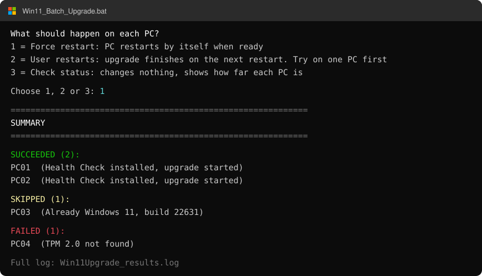

# Windows 11 Batch Upgrade

[](LICENSE)


[](https://github.com/Gren-95/win11-batch-upgrade/commits/main)
[](https://github.com/Gren-95/win11-batch-upgrade/stargazers)

A batch script that starts the Windows 11 upgrade on many PCs at once from one admin
machine, using the Windows 11 Installation Assistant and PsExec. There is nothing to install on
the target PCs beforehand, and you get a summary and a log of which PCs succeeded or failed.



*Illustration of the menu and summary, with example PC names.*

## What it does

For each PC, one at a time, the script:

1. Pings it and skips it if it's offline.
2. Copies PC Health Check to `C:\` and installs it silently. A failure here is only a warning.
3. Copies the Installation Assistant to `C:\` and starts it silently as SYSTEM.

At the start it asks what should happen when the upgrade is ready:

| Option | Behaviour | Switches |
| --- | --- | --- |
| **1 - Force restart** | The PC restarts by itself when ready. | `/QuietInstall /SkipEULA /AutoUpgrade /NoRestartUI` |
| **2 - User restarts** | Asks the Assistant to wait, so the upgrade finishes on the next restart. **Experimental, see below.** | The same, plus `/NoReboot` |

## Warnings

- **Option 2 may still restart the PC by itself.** Microsoft doesn't document the Assistant's
  switches, and reports disagree on whether it can hold back the restart. Test on one spare PC
  and leave it for a few hours before using this on anyone's machine.
- **Either option can restart a PC with no visible warning**, because the prompt is hidden and
  the Assistant runs as SYSTEM. Unsaved work on it can be lost.
- **Running the script accepts the Windows license terms** on behalf of each PC (`/SkipEULA`).
  Make sure you are allowed to do that.

## Requirements

**On the admin PC**, put these in the same folder as `Win11_Batch_Upgrade.bat`. They are not
included in this repository. The script checks for them first and shows these links if any are
missing.

| File | Download |
| --- | --- |
| `PsExec64.exe` | [PSTools.zip](https://download.sysinternals.com/files/PSTools.zip) (take it out of the zip) |
| `Windows11InstallationAssistant.exe` | [Microsoft's Windows 11 download page](https://www.microsoft.com/software-download/windows11) |
| `WindowsPCHealthCheckSetup.msi` | [aka.ms/GetPCHealthCheckApp](https://aka.ms/GetPCHealthCheckApp) |

Run the script as a user who is a local administrator on the target PCs.

**On each target PC:**

- Replies to ping. A PC that blocks it is reported as offline.
- The `C$` admin share is reachable and PsExec can connect, which usually means File and Printer
  Sharing is allowed through the firewall.
- It meets the [Windows 11 system requirements](https://www.microsoft.com/windows/windows-11-specifications).

## Usage

Give the computer names in one of three ways. The first one found wins:

```bat
rem 1. As arguments
Win11_Batch_Upgrade.bat PC01 PC02 PC03

rem 2. In computers.txt next to the script
Win11_Batch_Upgrade.bat

rem 3. No arguments and no computers.txt: the script asks you to type them
Win11_Batch_Upgrade.bat
```

`computers.txt` has one name per line, and lines starting with `#` are comments:

```text
# Office
PC01
PC02
```

Then choose option 1 or 2 at the prompt.

## Results

The script ends with a list of succeeded and failed PCs, and adds the same results to
`Win11Upgrade_results.log` next to the script.

**"Upgrade started" only means the Assistant launched without an error**, not that the upgrade
finished or that the PC is ready to restart.

## Limitations

- PCs are handled one at a time.
- There is no check for whether a PC has finished upgrading.
- `C:\Windows11InstallationAssistant.exe` and `C:\WindowsPCHealthCheckSetup.msi` stay on each PC.

## Holding back the restart reliably

Microsoft documents a `/NoReboot` switch for `setup.exe` from the Windows 11 ISO, in
[Windows Setup command-line options](https://learn.microsoft.com/en-us/windows-hardware/manufacture/desktop/windows-setup-command-line-options).
It only holds back the first restart, and this script doesn't use it, because that would mean
copying the full ISO to every PC.

## License

[MIT](LICENSE). PsExec, the Installation Assistant and PC Health Check are Microsoft software
under their own licenses.
